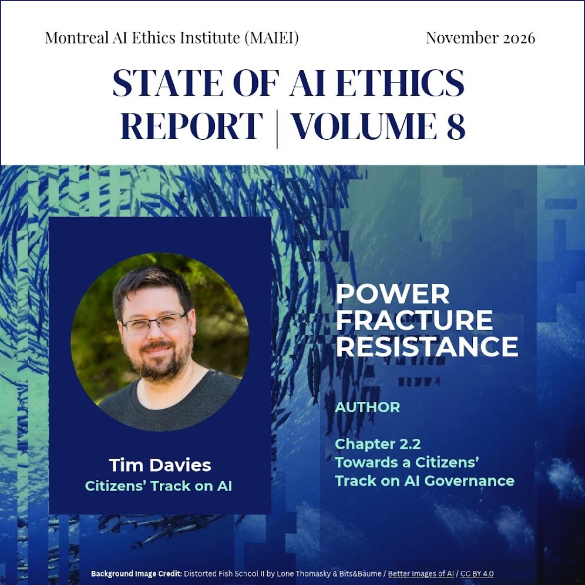

The Citizens' Track on AI is featured in the latest edition of the [Montreal AI Ethics Institute's State of AI Ethics Report](https://montrealethics.ai/saier-vol-8-landing/) as Chapter 2.2

We have reproduced the article here under CC-BY license.

There is a democratic deficit at the heart of AI development. Too often, choices about what to build and how it is governed, even when filtered through ethical or trustworthy AI frameworks, are made without engagement of the communities the technology will ultimately affect. Despite ‘democracy’ featuring as one of the themes of the [New Delhi AI Summit](https://impact.indiaai.gov.in/) in February 2026, the agenda was framed in terms of [increasing public access to AI tools, whilst doing little to promote democratic decision](https://www.deccanherald.com/opinion/ai-summit-democratisation-must-mean-power-not-just-access-3895716) at the community level on AI design or deployment. When [the first UN Global Dialogue on AI Governance met in Geneva in July 2026](https://www.un.org/global-dialogue-ai-governance/sites/default/files/2026-09/ai_dialogue_co-chairs_summary.pdf), the [Independent International Scientific Panel on AI](https://www.un.org/independent-international-scientific-panel-ai/en) noted that the published science that formed a foundation for the dialogue was limited in the voices it captured and the extent to which peer-reviewed evidence lags lived experience. This international story is reflected in national, local, and organisational practices: where [policies and strategies are shaped with reference only to ‘AI experts’](https://www.cigionline.org/publications/missing-persons-the-case-of-national-ai-strategies/), despite an established field of participatory practice that shows how affected communities can be part of the process.

Over recent years, a participatory turn in AI has put forward principles, frameworks and methods that can centre public voices in AI science ([Matias and Price, 2025](https://www.pnas.org/doi/10.1073/pnas.2421111122)), innovation pipelines ([Lawrence and Montgomery, 2026](https://academic.oup.com/spp/advance-article/doi/10.1093/scipol/scag070/8746319)), AI development ([Delgado et. al. 2023](https://dl.acm.org/doi/10.1145/3617694.3623261)), procurement ([P4AI](https://p4ai.net/); [Hudig et al. 2026](https://dl.acm.org/doi/full/10.1145/3772318.3791968)), governance ([Alanoca et. al, 2026](https://pairs.site/presentations/pairs2026/voice-to-the-people-comparing-deliberative-and-par/)) and resistance ([Sieber, 2026](https://pairs.site/presentations/pairs2026/citizen-resistance-to-ai/)). Despite this, participatory approaches have remained largely in the margins rather than the mainstream ([Davies and Tennison, 2025](https://www.techpolicy.press/the-participatory-turn-side-road-or-highway/)). The year ahead provides an opportunity for this to change. 

The [Citizens’ Track on AI (CTAI)](https://www.citizens-track.org/), launched alongside the UN Global Dialogue on AI Governance in Geneva, [sets out a blueprint](https://www.citizens-track.org/2026/report/) for addressing both supply-side and demand-side barriers between public voice and policy impact. It was accompanied by the launch of the [Participatory AI Voice and Engagement (PAVE) Case Book](https://pave.pairs.site). This documents over 80 existing participatory processes on AI around the world, from engagement around [data centre development in India](https://pave.pairs.site/cases/just-ai-just-land-socio-environmental-implications-of-data-centers-on-communities.html) to [distributed dialogues shaping rules for generative AI in education in the UK](https://pave.pairs.site/cases/generative-ai-in-education-have-your-say.html). In doing so, it both points to a vibrant and growing field of participatory practice around AI, but also highlights gaps in terms of the voices included, and a critical broken link between public voices expressed, and power holders listening. 

To address this requires action on multiple levels. 

At the grassroots, it calls for an expansion of the opportunity for communities to enter into dialogue about their hopes and fears about AI. A forthcoming [community assembly toolkit](https://www.citizens-track.org/toolkit/), co-developed with input from practitioners across the world, will test the hypothesis that, by meeting for facilitated deliberation, diverse communities right across the world can express meaningful demands of the global AI governance system \- and at the same time find greater agency in their local decision making on AI. Some community assemblies may take place online, and all will be encouraged to share messages for global policy audiences. However, the Citizens’ Track is placing a significant emphasis on in-person convenings that provide agenda space for discussion of local actions in order to foster inclusive collective empowerment, and to address the widespread sense that AI is done to, rather than explored with, communities. 

At the global level, there is a critical need to [develop ‘docking points’ for public voice:](https://glocan.org/wp-content/uploads/2025/06/GloCAN-Exchange-4-Docking.pdf) embedded opportunities where diverse evidence from lived experience around the world can feed into narratives and debates over AI governance, and into AI development \- support better alignment of both policy and technology with inclusive understandings of public interest. 2027 provides two critical moments for this, when the [UN Global Dialogue meets again in New York in early May 27](https://www.un.org/global-dialogue-ai-governance/en), closely followed by the [Geneva AI Summit](https://genevaaisummit.swiss/) (June 27). The challenge ahead is to find ways that the Dialogue, with its commitment to inclusion, and the Geneva Summit, rooted in Swiss democratic culture, can set new precedents on direct engagement with citizen voice as a key part of multistakeholder governance. 

And to tie this together requires a middle layer: a [data commons](https://aapti.in/fostering-participatory-data-stewardship/) and institutional interface that can responsibly aggregate insights from grassroots public engagement, and provide the kinds of synthesis that are legible and actionable for industry and policy-makers, without leaving public voice void of its power or as easily ignored tokenism. One critical challenge here is in showing how direct public input can both inform and strengthen, rather than displace, sustained civil society engagement in AI governance processes \- particularly in a context of industry-dominated narrative and agenda-setting. 

The CTAI initiative is gathering pace, but success is far from assured. In the US, the [Bloom project has announced support for 20 community assemblies on AI](http://bloom-project.org/cohort/); and groups across the world are preparing to use the [CTAI community assembly toolkit](https://citizens-track.org/toolkit/), developed with support from the [Swiss Federal Department of Foreign Affairs](https://www.fdfa.admin.ch/en/democracy). At the same time, funding for democratic engagement around AI across the world remains scarce: with philanthropists often focussed more on AI for good initiatives and using AI for digitally-mediated participation, rather than backing the participatory governance of AI. In a context where entrenched power-holders may be looking for excuses to dismiss public voices articulating alternative AI futures, proposals such as [the recent call for a global citizens’ assembly of 1,000 people to set the pace of industry AI development](https://www.noemamag.com/let-the-people-decide-the-pace-of-frontier-ai/) risk being seen as competing projects rather than complementary interventions. 

However, as the [PAVE Case Book](https://pave.pairs.site), and parallel mapping of the wider participation field highlight, strengthening public voice in AI governance demands a plurality of efforts. Democracy is an ongoing project, and creating a citizens track is not just a global effort. It is an idea that can be explored in any AI initiative through the simple question: whose voices are shaping the decisions we make?   