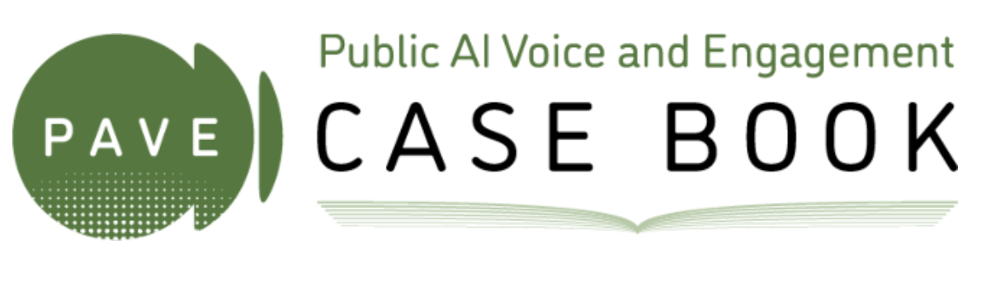
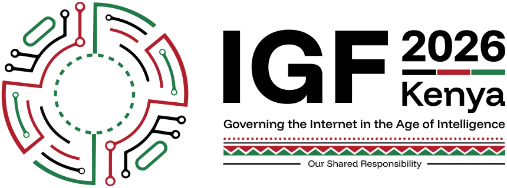

> Make sure you are [subscribed](/#subscribe) to receive future updates by e-mail.

This is the November update from the Citizens' Track on AI (CTAI) project. 

There are a few quick calls for input and survey's linked in this months bulletin, so please do bookmark any you might need to come back to over the week ahead! 

**In brief:**

* **Do you want to run a community assembly on AI next year?** Fill in the [expression of interest by 15th Dec](https://citizens-track.org/assembly/)
* **Planning to be at Geneva AI Summit in June 2027?** Tell us about plans for participatory activites and join a coordinated response to the Summit's call for input [by Friday 4th December](https://docs.google.com/forms/d/e/1FAIpQLScOotFkVrgIUsau-MGL8bpv5iXQAMj04s02RXfJrHto4vLaJg/viewform).
* **Do you know of public engagement on AI that should be in the PAVE Case Book?** Add it to the map [during the PAVE Team's latest research sprint](https://form.pavecasebook.org/)
* **Get updates from the Community Assembly Toolkit co-design cohort** with a sneak preview of upcoming guidance and resources. 

## Do you want to run a community assembly on AI? Expression of interest now open

A community assembly on AI might bring together an inclusive group of 15 - 50 people for 4 - 8 hours to learn about and deliberate on the impacts of articial intelligence, and to identify local and global actions required for a better AI future. 

In January, we will be launching a package of support for community assemblies on AI - including training, toolkits, and micro-grants. 

We've just opened [a call for expressions of interest](https://citizens-track.org/assembly/) for groups who would like to be part of this work. Deadline for submissions is 15th December. 

If you've already told us you are interested in running a community assembly in 2027, or you have new interest to share, please fill in the [quick form](https://citizens-track.org/assembly/) to share an update on your ideas or plans. 

## Road to Geneva: survey on participatory AI plans for the 2027 AI Summit

The 2027 Geneva AI Summit (GAIS27) has opened a call for input accessible from the [Summit website](https://genevaaisummit.swiss). To support coordinated responses to the call, and joint planning for activities in Geneva, we’re supporting a short survey of how groups focussed on participatory AI plan to engage in GAIS27.

If your organisation is planning participation-focussed activities for the Geneva AI Summit next year [fill in the quick survey here before Friday 4th December](https://docs.google.com/forms/d/e/1FAIpQLScOotFkVrgIUsau-MGL8bpv5iXQAMj04s02RXfJrHto4vLaJg/viewform).

## Expanding the PAVE Case Book: share your inputs

The Public AI Voice and Engagement (PAVE) Case Book is open for new suggestions and submissions, as Roshni, Isio and Kandy at the Ada Lovelace Institute get stuck into a new research sprint. 

**Has there been a recent participatory dialogue, or public deliberation on any topic connected to artificial intelligence in your country or networks?** If so - help us make sure it is amplified through the PAVE Case Book. 

[The updated simple submission form](https://form.pavecasebook.org/) lets you nominate a case in just a few minutes by providing a title, link and short description - or, you provide full details of a project, participants, process and outcome. 

To expand the coverage of the Case book we are looking particularly (but not exclusively) for recent examples of:

* Projects from Latin America, Africa, Asia and Australasia;  
* Local, National and Regional Citizens’ Assemblies on AI;  
* Community dialogues on AI that place emphasis on including diverse groups;  
* Participatory research projects initiated or led from the majority world;

You can check the existing projects covered by the case book [on our map](https://www.pavecasebook.org/map/).

Every submission is reviewed and edited with care by our human research team, and contributors are recognised on the case book website. 

The PAVE Case Book forms a central part of the [Citizens’ Track on AI](https://citizens-track.org/) - building a rich dataset of the projects and people raising community voices on the future of AI, and amplifying actions and messages from these initiatives. 

## Updates from our toolkit co-design cohort

<figure class="post-thumb-right">
  
  <figcaption>Co-design cohort contributors</figcaption>
</figure>

Over weekly sessions across October we had the pleasure of working with a passionate group of practitioners as part of our Community Assembly Toolkit co-design process. We shared existing activities to support community learning on AI, discussed approaches to support effective deliberation, designed new activities for dialogue and action, and explored how resources might be translated and localised.

We're still putting finishing touches to an alpha version of the Community Assembly Toolkit which we now hope to release in early December containing:

* A step-by-step guide to planning and running a community assembly;
* Ready to use agendas and activities;
* Adaptable slides and workshop resources;
* Approaches to support participant feedback and follow-up.

The screenshots below give a sneak-preview of what's in store. 

  <button type="button" class="gallery-thumb" data-full="{{ '/assets/posts/ctai-toolkit-alpha-guidance.png' | relative_url }}" data-caption="Toolkit Guidance: Structured step-by-step guidance for assembly organizers">
    
    Toolkit Guidance
  </button>
  <button type="button" class="gallery-thumb" data-full="{{ '/assets/posts/ctai-alpha-agenda.png' | relative_url }}" data-caption="Agenda Builder: Flexible workshop agenda planning tool">
    
    Agenda Builder
  </button>
  <button type="button" class="gallery-thumb" data-full="{{ '/assets/posts/ctai-toolkit-alpha-better-images.png' | relative_url }}" data-caption="Icebreaker Activity: Hands-on community engagement prompt">
    
    Icebreaker Activity
  </button>
  <button type="button" class="gallery-thumb" data-full="{{ '/assets/posts/ctai-toolkit-alpha-card-printer.png' | relative_url }}" data-caption="Workshop Cards: Ready-to-print discussion and reflection cards">
    
    Printable Cards
  </button>

<!-- Lightbox overlay -->

  <button id="lightbox-close" aria-label="Close lightbox">&times;</button>
  <figure>
    
    <figcaption id="lightbox-caption"></figcaption>
  </figure>

## CTAI at the Internet Governance Forum

The Citizens’ Track on AI will have a stand in the exhibition space at Internet Governance Forum in Nairobi, Kenya from 14th - 18th December - and Johnny, Susan and Octavia from the team will be there to share updates on our community assembly, evidence and policy work. 

We’re also looking for volunteers to help on the PAVE/Citizens’ Track exhibition stand during the week, and would love to connect CTAI community members who will also be in Nairobi that week. Get in touch with contact@citizens-track.org if you will be there!

## Other updates

* The Citizens’ Track on AI is [featured in the latest edition of the Montreal AI Ethics Institute’s State of AI Ethics Report as Chapter 2.2](https://citizens-track.org/2026/11/10/saier-citizens-track.html)
* CTAI partners in the USA have [extended their call for US-based Civic Hosts for community assemblies on AI until Monday November 23rd 9am PT](https://bloom-project.org/cohort/)
* PAIRS, the Participatory AI Research and Practice Symposium (taking place online on 18th June, and in Geneva 19th June 2027) has [an open call for extended abstracts. Deadline 15th December.](https://pairs.site/2027/cfp)
* Read [how PAVE and CTAI deliver on the UN Global Digital Compact](https://citizens-track.org/2026/11/18/delivering-on-global-digital-compact.html) in this guest post from Dr Susan Oman
