# Citizens' Track on AI — Brand Guidelines & Design System

> **Official Design Specification & Asset Guide**  
> **Brand Version:** 1.0 (October 2026)  
> **Originator:** Convincible / Connected By Data  
> **Web:** [citizens-track.org](https://citizens-track.org)  
> **Primary Audience:** AI Agents, Frontend Developers, UI/UX Designers, Content Creators

---

## Table of Contents
1. [AI Agent Quick Directives](#1-ai-agent-quick-directives)
2. [Naming & Describing the Project](#2-naming--describing-the-project)
3. [Logo System & Assets](#3-logo-system--assets)
   - [Logo Elements & Anatomy](#logo-elements--anatomy)
   - [Variants: Wide vs. Stacked](#variants-wide-vs-stacked)
   - [Colourways & Contexts](#colourways--contexts)
   - [Asset Directory & File Reference](#asset-directory--file-reference)
   - [Logo Clear Space & Alignment](#logo-clear-space--alignment)
   - [Logo Nogos (Forbidden Practices)](#logo-nogos-forbidden-practices)
4. [Color Palette & Tokens](#4-color-palette--tokens)
   - [Primary Palette](#primary-palette)
   - [Secondary Palette](#secondary-palette)
   - [Approved Color Pairings & Contrast](#approved-color-pairings--contrast)
5. [Typography](#5-typography)
   - [Primary Font: Parkinsans](#primary-font-parkinsans)
   - [Hierarchy & Sizing Scale](#hierarchy--sizing-scale)
6. [Iconography & Data Graphics](#6-iconography--data-graphics)
   - [Icon Style Rules](#icon-style-rules)
   - [Transparent Icon Catalog](#transparent-icon-catalog-available-in-imagesicons)
   - [Charts & Diagrams](#charts--diagrams)
7. [Implementation Kit for Web & Apps](#7-implementation-kit-for-web--apps)
   - [CSS Custom Properties (Tokens)](#css-custom-properties-tokens)
   - [Tailwind CSS Configuration](#tailwind-css-configuration)
   - [HTML / SVG Header Snippet](#html--svg-header-snippet)

---

## 1. AI Agent Quick Directives

When building pages, components, graphics, or web applications for **Citizens' Track on AI**, follow these non-negotiable rules:

| Element | Directive | What to Avoid |
| :--- | :--- | :--- |
| **Project Name (in text)** | Always write **Citizens' Track on AI** in full, or abbreviate to **CT//AI** or **CTAI**. | **NEVER write "Citizens' Track AI", "Citizens' Track" alone, or "AI Citizens' Track" in text.** |
| **Primary Font** | Load **`Parkinsans`** via Google Fonts; use `Arial, sans-serif` as fallback. | Never use default system serif fonts or generic sans like Roboto/Inter without Parkinsans first. |
| **Light Canvas** | Body background: **Spring Wood** (`#EFEEE5`); Surface cards: `#FFFFFF` or `#F8F7F2`. | Avoid stark clinical `#FFFFFF` for the full page body. |
| **Dark Canvas** | Body background: **Ebony Clay** (`#242C36`); Deep containers: **Fjord** (`#00447C`). | Avoid muddy greys or pure `#000000` pitch black. |
| **Brand Colors** | Dominant brand header/hero: **Fjord** (`#00447C`). Key accent: **Cerulean** (`#40A9FF`). | Never use uncurated blues (e.g. browser `#0000FF`). |
| **Logo Choice** | On light surfaces: **Wide Positive** (`logo-wide-positive.svg`). On dark surfaces: **Wide Negative** (`logo-wide-negative.svg`). | Never recolor, stretch, skew, or rotate the logo. |
| **Contrast Rule** | Always pair a **light color with a dark color**. | **NEVER pair two light colors or two dark colors together.** |
| **Icon Style** | Thin outlined strokes with consistent line weights, rounded terminals, on solid Fjord or transparent backgrounds. | Avoid solid glyph fills or heavy drop-shadows. |

---

## 2. Naming & Describing the Project

When writing, speaking, or generating text referring to the initiative, adhere strictly to the following editorial naming conventions:

### Approved Ways to Refer to the Project in Text
The **only** approved ways of talking about the initiative in text are:
1. **In full as:** **`Citizens' Track on AI`**
2. **Abbreviated to:** **`CT//AI`** or **`CTAI`**

> **Crucial Rule:**  
> We should **always** talk about the **Citizens' Track on AI** — and **never** "Citizens' Track AI" in text.  
> *(Note: The logo graphic artwork visually displays the design lockup `Citizens' Track //AI`, but all written copy, prose, metadata, and headings must include the preposition "on".)*

### Editorial Prohibitions & Nogos (Text Copy)
- ❌ **NEVER write "Citizens' Track AI" in text.** (Always use *"Citizens' Track on AI"*).
- ❌ **NEVER refer to it as "Citizens' Track" alone.** (Omits the AI focus and is unapproved).
- ❌ **NEVER write "AI Citizens' Track".** (Inverting the words is strictly forbidden).

| Status | Name Format | Usage Context |
| :--- | :--- | :--- |
| ✅ **Approved (Full)** | **Citizens' Track on AI** | Primary written standard for all body copy, press releases, page titles, and introductions. |
| ✅ **Approved (Abbreviation)** | **CT//AI** | Stylized abbreviation matching the brand's forward-slash design motif. |
| ✅ **Approved (Abbreviation)** | **CTAI** | Standard plain-text abbreviation for URLs, filenames, database tables, and compact UI tags. |
| ❌ **Forbidden in text** | *Citizens' Track AI* | Artwork logo lockup only. Do not use in written prose or text. |
| ❌ **Forbidden in text** | *Citizens' Track* | Incomplete reference. |
| ❌ **Forbidden in text** | *AI Citizens' Track* | Inverted word order. |

---

## 3. Logo System & Assets

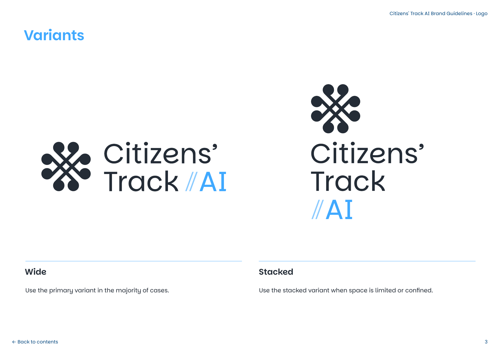

### Logo Elements & Anatomy
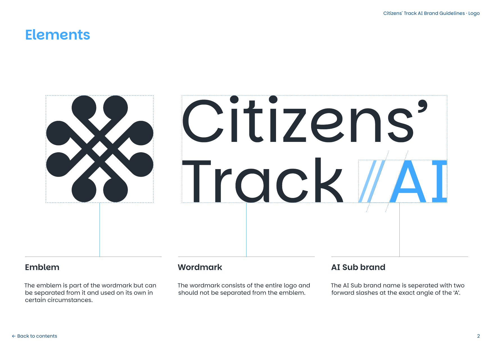

The logo is composed of three interconnected elements:
1. **The Emblem:** An interlocking path motif featuring circular nodes at terminals, symbolizing multi-stakeholder connection, citizen deliberation, and governance tracks. Can be separated and used on its own as an avatar, favicon, or app icon.
2. **The Wordmark:** The precision typography spelling `"Citizens' Track"`. It must never be separated from the emblem when using the full logo.
3. **The AI Sub-brand:** The identifier `"//AI"`. The two forward slashes are pitched at the **exact angle of the letter 'A'**.

---

### Variants: Wide vs. Stacked

| Variant | Layout Description | Recommended Context |
| :--- | :--- | :--- |
| **Wide (Primary)** | Emblem on the left, two-line text (`Citizens'` / `Track //AI`) on the right. | **Default for 90% of uses:** Website navbars, document headers, slide titles, hero sections. |
| **Stacked** | Emblem centered on top, three/four-line centered text beneath. | Constrained width: Mobile layouts, social cards, square banners, vertical sidebars. |
| **Emblem Standalone** | Just the interlocking node track emblem. | Favicons, profile avatars, app icons, subtle background watermarks. |

---

### Colourways & Contexts
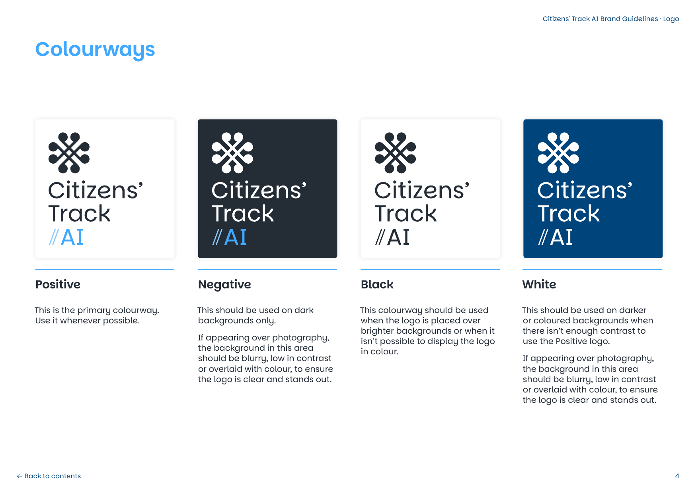

1. **Positive (Primary Colourway):**
   - Wordmark & Emblem: **Ebony Clay** (`#242C36`)
   - Sub-brand `//AI`: **Cerulean** (`#40A9FF`)
   - *Use whenever possible on light or neutral backgrounds.*
2. **Negative:**
   - Wordmark & Emblem: **White** (`#FFFFFF`)
   - Sub-brand `//AI`: **Cerulean** (`#40A9FF`)
   - *Use on dark surfaces (Ebony Clay, Fjord) or darkened photography.*
3. **White (Monochrome Light):**
   - Entire logo: **White** (`#FFFFFF`)
   - *Use on dark or saturated backgrounds where Cerulean lacks sufficient contrast.*
4. **Black (Monochrome Dark):**
   - Entire logo: **Ebony Clay** (`#242C36`) / Black
   - *Use over bright single-color backgrounds or single-color grayscale print.*

---

### Asset Directory & File Reference

All logo files are pre-rendered in vector SVG (infinitely scalable, transparent background) and high-resolution 300 DPI transparent PNG:

| Asset Name | Vector SVG | High-Res PNG | Preview |
| :--- | :--- | :--- | :--- |
| **Wide Positive (Primary)** | [logo-wide-positive.svg](images/logos/logo-wide-positive.svg) | [logo-wide-positive.png](images/logos/logo-wide-positive.png) | 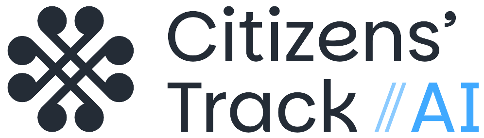 |
| **Wide Negative** | [logo-wide-negative.svg](images/logos/logo-wide-negative.svg) | [logo-wide-negative.png](images/logos/logo-wide-negative.png) | *(White on transparent)* |
| **Wide White** | [logo-wide-white.svg](images/logos/logo-wide-white.svg) | [logo-wide-white.png](images/logos/logo-wide-white.png) | *(All-white monochrome)* |
| **Wide Black** | [logo-wide-black.svg](images/logos/logo-wide-black.svg) | [logo-wide-black.png](images/logos/logo-wide-black.png) | 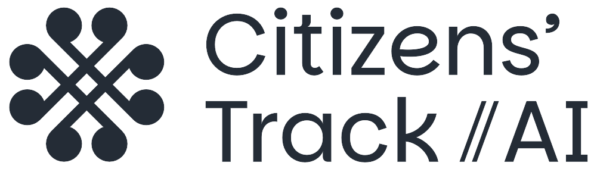 |
| **Stacked Positive** | [logo-stacked-positive.svg](images/logos/logo-stacked-positive.svg) | [logo-stacked-positive.png](images/logos/logo-stacked-positive.png) | 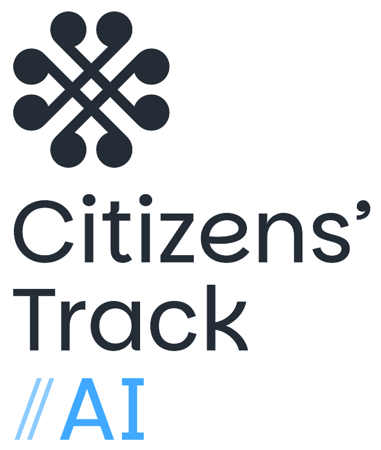 |
| **Stacked Negative** | [logo-stacked-negative.svg](images/logos/logo-stacked-negative.svg) | [logo-stacked-negative.png](images/logos/logo-stacked-negative.png) | *(White on transparent)* |
| **Stacked White** | [logo-stacked-white.svg](images/logos/logo-stacked-white.svg) | [logo-stacked-white.png](images/logos/logo-stacked-white.png) | *(All-white monochrome)* |
| **Stacked Black** | [logo-stacked-black.svg](images/logos/logo-stacked-black.svg) | [logo-stacked-black.png](images/logos/logo-stacked-black.png) | 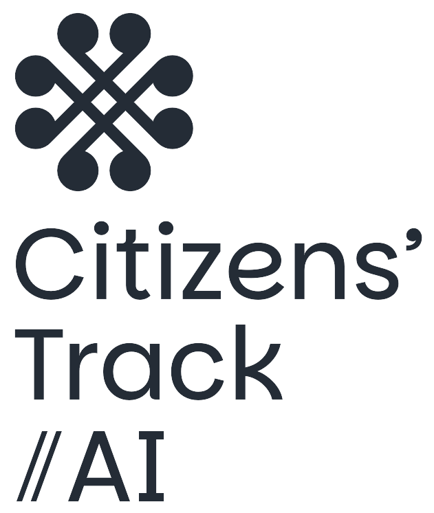 |
| **Emblem (Positive)** | [emblem-positive.svg](images/logos/emblem-positive.svg) | [emblem-positive.png](images/logos/emblem-positive.png) |  |
| **Emblem (Cerulean)** | [emblem-cerulean.svg](images/logos/emblem-cerulean.svg) | [emblem-cerulean.png](images/logos/emblem-cerulean.png) | 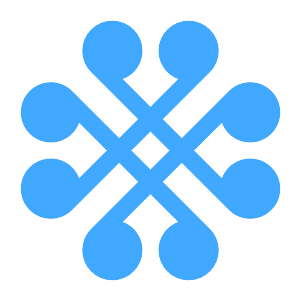 |
| **Emblem (Coral)** | [emblem-coral.svg](images/logos/emblem-coral.svg) | [emblem-coral.png](images/logos/emblem-coral.png) | 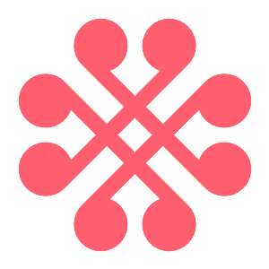 |
| **Emblem (White)** | [emblem-white.svg](images/logos/emblem-white.svg) | [emblem-white.png](images/logos/emblem-white.png) | *(White on transparent)* |
| **Favicon** | [favicon.svg](images/logos/favicon.svg) | [favicon.png](images/logos/favicon.png) |  |

---

### Logo Clear Space & Alignment

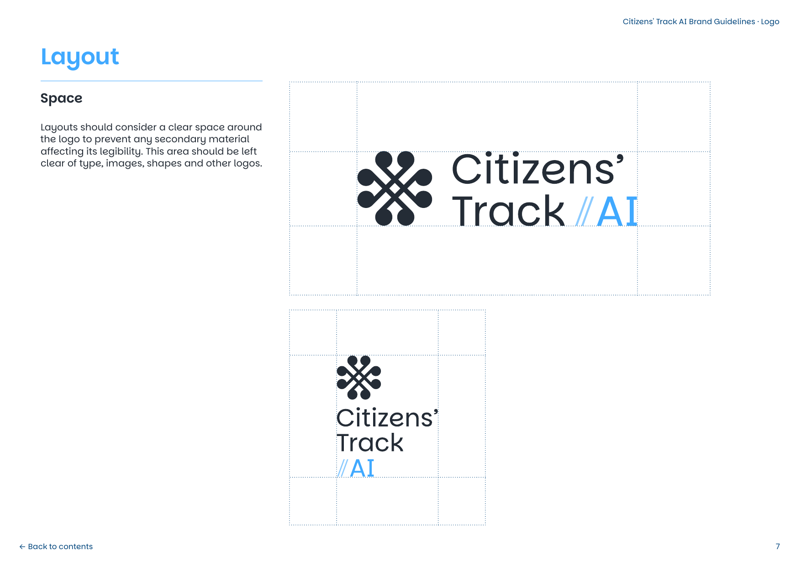
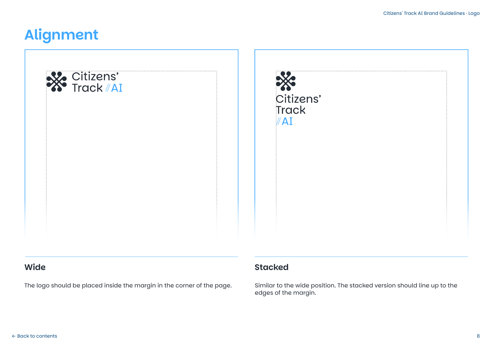

- **Clear Space:** Maintain a protected clear zone around the logo free from typography, buttons, shapes, or competing logos. The clear margin equals the dimension of an emblem node / terminal.
- **Alignment:** 
  - Place wide logos neatly inside the margin in the corner of pages or navigation bars.
  - Stacked logos must align to margin edges along their bounding rectangle.

---

### Logo Nogos (Forbidden Practices)
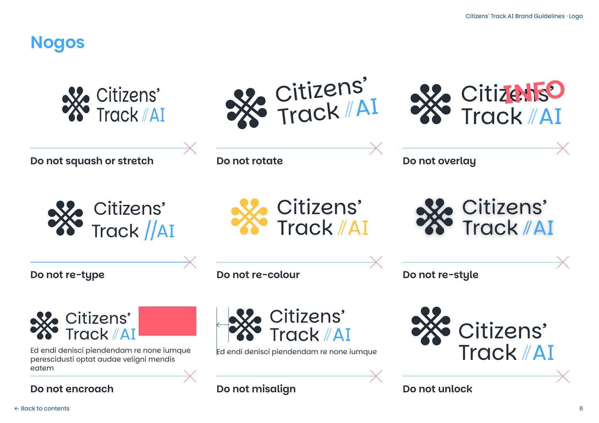

The logo identity must be strictly preserved:
- ❌ **Do not squash or stretch:** Never change the horizontal or vertical proportions.
- ❌ **Do not rotate:** Logo must remain oriented horizontally.
- ❌ **Do not overlay text:** Secondary badges or labels must not cross the logo perimeter.
- ❌ **Do not re-type:** Never rebuild the logo in arbitrary fonts.
- ❌ **Do not re-colour:** Do not apply gradients, unapproved neon tones, or rainbow colors.
- ❌ **Do not re-style:** Do not add heavy drop shadows, glows, bevels, or borders.
- ❌ **Do not encroach:** Respect clear margin space.
- ❌ **Do not misalign:** Keep lockup relationships exact.
- ❌ **Do not unlock:** Do not separate the emblem from the wordmark within the logo lockup.

---

## 4. Color Palette & Tokens

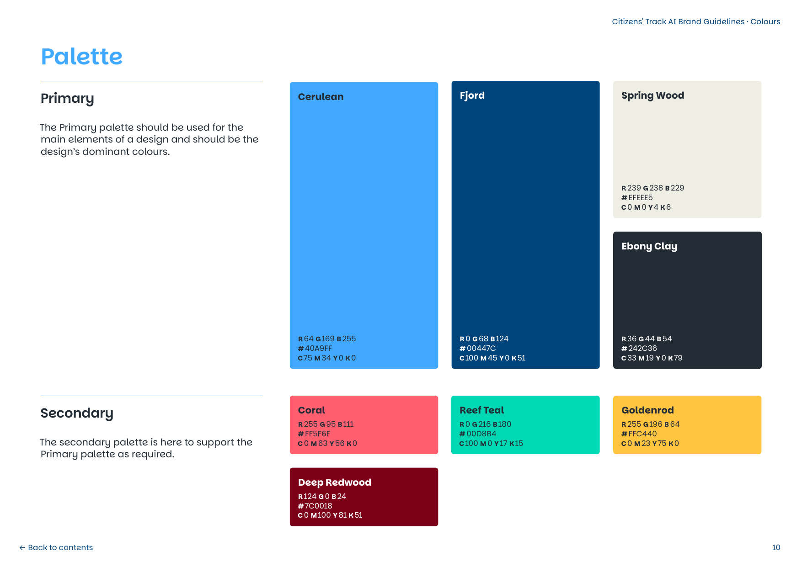

### Primary Palette
Dominates 80%+ of brand surfaces and interfaces.

| Color Name | Swatch | HEX | RGB | CMYK | Usage Role |
| :--- | :---: | :--- | :--- | :--- | :--- |
| **Cerulean** | <span style="background-color:#40A9FF;display:inline-block;width:32px;height:20px;border-radius:4px;border:1px solid #ccc;"></span> | `#40A9FF` | `64, 169, 255` | `C:75 M:34 Y:0 K:0` | Key brand accent, `//AI` sub-brand, interactive active states, primary links |
| **Fjord** | <span style="background-color:#00447C;display:inline-block;width:32px;height:20px;border-radius:4px;"></span> | `#00447C` | `0, 68, 124` | `C:100 M:45 Y:0 K:51` | Deep authoritative blue, card backgrounds, dark headers, key hero blocks |
| **Spring Wood** | <span style="background-color:#EFEEE5;display:inline-block;width:32px;height:20px;border-radius:4px;border:1px solid #ddd;"></span> | `#EFEEE5` | `239, 238, 229` | `C:0 M:0 Y:4 K:6` | Default light page background, warm neutral surface, card fills |
| **Ebony Clay** | <span style="background-color:#242C36;display:inline-block;width:32px;height:20px;border-radius:4px;"></span> | `#242C36` | `36, 44, 54` | `C:33 M:19 Y:0 K:79` | Primary typography, dark canvas surface, positive logo text/emblem |

---

### Secondary Palette
Supports the primary palette for data visualization, highlights, callouts, and category indicators.

| Color Name | Swatch | HEX | RGB | CMYK | Usage Role |
| :--- | :---: | :--- | :--- | :--- | :--- |
| **Coral** | <span style="background-color:#FF5F6F;display:inline-block;width:32px;height:20px;border-radius:4px;"></span> | `#FF5F6F` | `255, 95, 111` | `C:0 M:63 Y:56 K:0` | Callouts, high-visibility badges, attention anchors, chart data |
| **Reef Teal** | <span style="background-color:#00D8B4;display:inline-block;width:32px;height:20px;border-radius:4px;"></span> | `#00D8B4` | `0, 216, 180` | `C:100 M:0 Y:17 K:15` | Success markers, positive trends, vibrant accents on Fjord/Ebony |
| **Goldenrod** | <span style="background-color:#FFC440;display:inline-block;width:32px;height:20px;border-radius:4px;"></span> | `#FFC440` | `255, 196, 64` | `C:0 M:23 Y:75 K:0` | Warning highlights, progress milestones, secondary chart category |
| **Deep Redwood** | <span style="background-color:#7C0018;display:inline-block;width:32px;height:20px;border-radius:4px;"></span> | `#7C0018` | `124, 0, 24` | `C:0 M:100 Y:81 K:51` | Deep contrast anchor, critical alerts, dark emphasis |

---

### Approved Color Pairings & Contrast
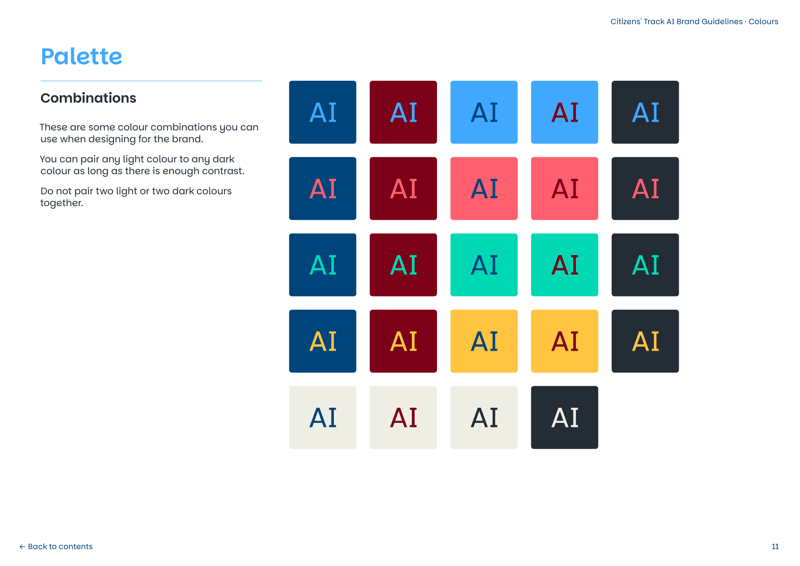

> **Golden Rule of Brand Contrast:**  
> Pair any light color to any dark color as long as there is sufficient contrast.  
> **Do NOT pair two light or two dark colors together.**

#### High-Performing Pairs:
- **Dark text on Light Background:**
  - `Ebony Clay (#242C36)` on `Spring Wood (#EFEEE5)` (Primary body text)
  - `Fjord (#00447C)` on `Spring Wood (#EFEEE5)` (Headings, buttons)
  - `Deep Redwood (#7C0018)` on `Spring Wood (#EFEEE5)` (Alerts, emphasis)
- **Light text on Dark Background:**
  - `White (#FFFFFF)` on `Fjord (#00447C)` (Hero cards, navigation bar)
  - `Cerulean (#40A9FF)` on `Fjord (#00447C)` (Active tabs, highlighted text)
  - `Reef Teal (#00D8B4)` on `Fjord (#00447C)` or `Ebony Clay (#242C36)` (Key metrics, tags)
  - `Goldenrod (#FFC440)` on `Fjord (#00447C)` or `Ebony Clay (#242C36)` (Badges)
- **Forbidden Pairs:**
  - ❌ Cerulean on Reef Teal (Insufficient contrast)
  - ❌ Goldenrod on Spring Wood (Light on light)
  - ❌ Deep Redwood on Fjord (Dark on dark)
  - ❌ Ebony Clay on Deep Redwood (Dark on dark)

---

## 5. Typography

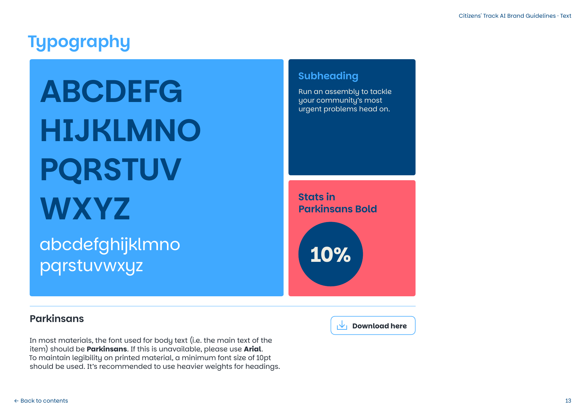

### Primary Font: Parkinsans
The official typeface for Citizens' Track on AI is **Parkinsans** (designed by Neil Summerour).
- **Google Fonts Link:** [Parkinsans on Google Fonts](https://fonts.google.com/specimen/Parkinsans?preview.script=Latn)
- **Fallback Font:** `Arial, sans-serif` (use only if Parkinsans is unable to load).

```html
<!-- HTML Font Import -->
<link rel="preconnect" href="https://fonts.googleapis.com">
<link rel="preconnect" href="https://fonts.gstatic.com" crossorigin>
<link href="https://fonts.googleapis.com/css2?family=Parkinsans:wght@300;400;500;600;700;800&display=swap" rel="stylesheet">
```

```css
/* CSS Font Rule */
body {
  font-family: 'Parkinsans', Arial, sans-serif;
  color: var(--ct-color-ebony-clay);
}
```

---

### Hierarchy & Sizing Scale

| Level | Weight | Size (Desktop / Mobile) | Line Height | Recommended Usage |
| :--- | :--- | :--- | :--- | :--- |
| **Display / Hero H1** | Bold (700) or ExtraBold (800) | `3.25rem (52px)` / `2.25rem` | 1.15 | Main hero title, landing page headline |
| **Heading H2** | Bold (700) | `2.25rem (36px)` / `1.75rem` | 1.25 | Section headings |
| **Heading H3** | SemiBold (600) | `1.5rem (24px)` / `1.25rem` | 1.3 | Feature cards, modal titles |
| **Subheadings** | Medium (500) | `1.125rem (18px)` | 1.4 | Intro paragraphs, deck copy |
| **Body Text** | Regular (400) | `1rem (16px)` | 1.6 | Paragraphs, documentation, articles |
| **Stats / Numbers** | **Bold (700)** | `2.5rem – 4rem` | 1.0 | Data callouts, metric badges (e.g. `10%`) |
| **Captions / Meta** | Medium (500) | `0.875rem (14px)` | 1.4 | Timestamps, tags, footnotes |

> **Print Minimum:** Font size must not drop below `10pt` on printed material.

---

## 6. Iconography & Data Graphics

### Icon Style Rules
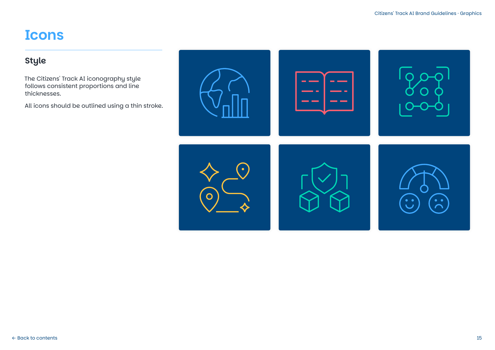

1. **Stroke Weight:** Outlined with thin, uniform stroke lines (`stroke-width: 1.5px - 2px`).
2. **Geometry:** Consistent proportions with rounded joins and terminals.
3. **Backgrounds & Transparency:** All icons are provided as **standalone transparent SVGs and PNGs** without background fills, as well as boxed cards on Fjord backgrounds (`images/icons/cards/`).
4. **Colourways:** Rendered in monochrome brand shades matching both primary and secondary palettes.

---

### Transparent Icon Catalog (Available in `images/icons/`)

Each icon is available in vector **SVG** (infinitely scalable, transparent background) and 300 DPI transparent **PNG** across 8 official colourways:

| Icon Name | Meaning / Subject Matter | Cerulean (`#40A9FF`) | Reef Teal (`#00D8B4`) | Coral (`#FF5F6F`) | Goldenrod (`#FFC440`) | White (`#FFFFFF`) | Ebony (`#242C36`) | Fjord (`#00447C`) | Redwood (`#7C0018`) |
| :--- | :--- | :---: | :---: | :---: | :---: | :---: | :---: | :---: | :---: |
| **Globe & Stats** | Global assemblies, research, data | [SVG](images/icons/cerulean/icon-globe-chart.svg) \| [PNG](images/icons/cerulean/icon-globe-chart.png) | [SVG](images/icons/teal/icon-globe-chart.svg) \| [PNG](images/icons/teal/icon-globe-chart.png) | [SVG](images/icons/coral/icon-globe-chart.svg) \| [PNG](images/icons/coral/icon-globe-chart.png) | [SVG](images/icons/goldenrod/icon-globe-chart.svg) \| [PNG](images/icons/goldenrod/icon-globe-chart.png) | [SVG](images/icons/white/icon-globe-chart.svg) \| [PNG](images/icons/white/icon-globe-chart.png) | [SVG](images/icons/ebony/icon-globe-chart.svg) \| [PNG](images/icons/ebony/icon-globe-chart.png) | [SVG](images/icons/fjord/icon-globe-chart.svg) \| [PNG](images/icons/fjord/icon-globe-chart.png) | [SVG](images/icons/redwood/icon-globe-chart.svg) \| [PNG](images/icons/redwood/icon-globe-chart.png) |
| **Open Book** | Deliberation, evidence pack, education | [SVG](images/icons/cerulean/icon-open-book.svg) \| [PNG](images/icons/cerulean/icon-open-book.png) | [SVG](images/icons/teal/icon-open-book.svg) \| [PNG](images/icons/teal/icon-open-book.png) | [SVG](images/icons/coral/icon-open-book.svg) \| [PNG](images/icons/coral/icon-open-book.png) | [SVG](images/icons/goldenrod/icon-open-book.svg) \| [PNG](images/icons/goldenrod/icon-open-book.png) | [SVG](images/icons/white/icon-open-book.svg) \| [PNG](images/icons/white/icon-open-book.png) | [SVG](images/icons/ebony/icon-open-book.svg) \| [PNG](images/icons/ebony/icon-open-book.png) | [SVG](images/icons/fjord/icon-open-book.svg) \| [PNG](images/icons/fjord/icon-open-book.png) | [SVG](images/icons/redwood/icon-open-book.svg) \| [PNG](images/icons/redwood/icon-open-book.png) |
| **AI Network** | Generative AI, machine synthesis, grid | [SVG](images/icons/cerulean/icon-ai-network.svg) \| [PNG](images/icons/cerulean/icon-ai-network.png) | [SVG](images/icons/teal/icon-ai-network.svg) \| [PNG](images/icons/teal/icon-ai-network.png) | [SVG](images/icons/coral/icon-ai-network.svg) \| [PNG](images/icons/coral/icon-ai-network.png) | [SVG](images/icons/goldenrod/icon-ai-network.svg) \| [PNG](images/icons/goldenrod/icon-ai-network.png) | [SVG](images/icons/white/icon-ai-network.svg) \| [PNG](images/icons/white/icon-ai-network.png) | [SVG](images/icons/ebony/icon-ai-network.svg) \| [PNG](images/icons/ebony/icon-ai-network.png) | [SVG](images/icons/fjord/icon-ai-network.svg) \| [PNG](images/icons/fjord/icon-ai-network.png) | [SVG](images/icons/redwood/icon-ai-network.svg) \| [PNG](images/icons/redwood/icon-ai-network.png) |
| **Journey Map** | Citizen roadmap, milestones, consensus | [SVG](images/icons/cerulean/icon-journey-map.svg) \| [PNG](images/icons/cerulean/icon-journey-map.png) | [SVG](images/icons/teal/icon-journey-map.svg) \| [PNG](images/icons/teal/icon-journey-map.png) | [SVG](images/icons/coral/icon-journey-map.svg) \| [PNG](images/icons/coral/icon-journey-map.png) | [SVG](images/icons/goldenrod/icon-journey-map.svg) \| [PNG](images/icons/goldenrod/icon-journey-map.png) | [SVG](images/icons/white/icon-journey-map.svg) \| [PNG](images/icons/white/icon-journey-map.png) | [SVG](images/icons/ebony/icon-journey-map.svg) \| [PNG](images/icons/ebony/icon-journey-map.png) | [SVG](images/icons/fjord/icon-journey-map.svg) \| [PNG](images/icons/fjord/icon-journey-map.png) | [SVG](images/icons/redwood/icon-journey-map.svg) \| [PNG](images/icons/redwood/icon-journey-map.png) |
| **Shield & Cubes** | Privacy, governance guardrails, infra | [SVG](images/icons/cerulean/icon-shield-cubes.svg) \| [PNG](images/icons/cerulean/icon-shield-cubes.png) | [SVG](images/icons/teal/icon-shield-cubes.svg) \| [PNG](images/icons/teal/icon-shield-cubes.png) | [SVG](images/icons/coral/icon-shield-cubes.svg) \| [PNG](images/icons/coral/icon-shield-cubes.png) | [SVG](images/icons/goldenrod/icon-shield-cubes.svg) \| [PNG](images/icons/goldenrod/icon-shield-cubes.png) | [SVG](images/icons/white/icon-shield-cubes.svg) \| [PNG](images/icons/white/icon-shield-cubes.png) | [SVG](images/icons/ebony/icon-shield-cubes.svg) \| [PNG](images/icons/ebony/icon-shield-cubes.png) | [SVG](images/icons/fjord/icon-shield-cubes.svg) \| [PNG](images/icons/fjord/icon-shield-cubes.png) | [SVG](images/icons/redwood/icon-shield-cubes.svg) \| [PNG](images/icons/redwood/icon-shield-cubes.png) |
| **Sentiment Gauge** | Community pulse, polling, satisfaction | [SVG](images/icons/cerulean/icon-sentiment-gauge.svg) \| [PNG](images/icons/cerulean/icon-sentiment-gauge.png) | [SVG](images/icons/teal/icon-sentiment-gauge.svg) \| [PNG](images/icons/teal/icon-sentiment-gauge.png) | [SVG](images/icons/coral/icon-sentiment-gauge.svg) \| [PNG](images/icons/coral/icon-sentiment-gauge.png) | [SVG](images/icons/goldenrod/icon-sentiment-gauge.svg) \| [PNG](images/icons/goldenrod/icon-sentiment-gauge.png) | [SVG](images/icons/white/icon-sentiment-gauge.svg) \| [PNG](images/icons/white/icon-sentiment-gauge.png) | [SVG](images/icons/ebony/icon-sentiment-gauge.svg) \| [PNG](images/icons/ebony/icon-sentiment-gauge.png) | [SVG](images/icons/fjord/icon-sentiment-gauge.svg) \| [PNG](images/icons/fjord/icon-sentiment-gauge.png) | [SVG](images/icons/redwood/icon-sentiment-gauge.svg) \| [PNG](images/icons/redwood/icon-sentiment-gauge.png) |

#### Original Card Variants
Original solid card blocks with rounded corners on Fjord background are preserved in [images/icons/cards/](images/icons/cards/):
- Full 6-Icon Grid: [icons-grid.png](images/icons/cards/icons-grid.png)
- Individual Card PNGs: [cards/icon-globe-chart.png](images/icons/cards/icon-globe-chart.png), [cards/icon-open-book.png](images/icons/cards/icon-open-book.png), [cards/icon-ai-network.png](images/icons/cards/icon-ai-network.png), [cards/icon-journey-map.png](images/icons/cards/icon-journey-map.png), [cards/icon-shield-cubes.png](images/icons/cards/icon-shield-cubes.png), [cards/icon-sentiment-gauge.png](images/icons/cards/icon-sentiment-gauge.png)

---

### Charts & Diagrams
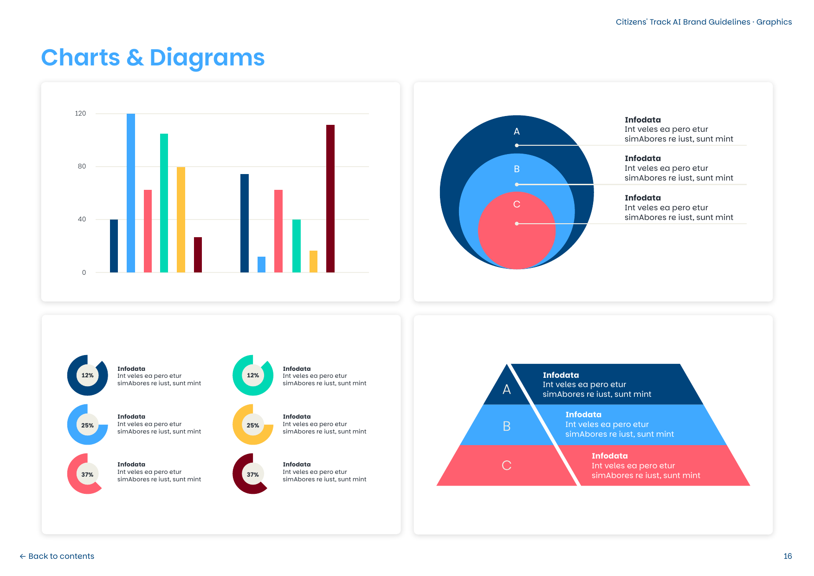

When building charts (Chart.js, Recharts, D3, or CSS bars):
- **Bar & Column Charts:** Use distinct brand categories:
  - Series 1: `Fjord (#00447C)`
  - Series 2: `Cerulean (#40A9FF)`
  - Series 3: `Reef Teal (#00D8B4)`
  - Series 4: `Coral (#FF5F6F)`
  - Series 5: `Goldenrod (#FFC440)`
  - Series 6: `Deep Redwood (#7C0018)`
- **Concentric Circles / Venns / Funnels:** Stack high-contrast shades (e.g. Fjord outer ring -> Cerulean mid ring -> Coral center focal).
- **Background Grid:** Light `rgba(36, 44, 54, 0.1)` on light backgrounds.

---

## 7. Implementation Kit for Web & Apps

### CSS Custom Properties (Tokens)
Directly include [brand-tokens.css](brand-tokens.css) in your web project:

```css
@import url('./brand-tokens.css');

/* Example component usage */
.ct-card {
  background-color: var(--ct-bg-surface);
  border: 1px solid var(--ct-border-subtle);
  border-radius: var(--ct-radius-md);
  padding: var(--ct-space-6);
  color: var(--ct-text-primary);
}

.ct-hero-banner {
  background-color: var(--ct-color-fjord);
  color: var(--ct-text-inverse);
  padding: var(--ct-space-12) var(--ct-space-8);
  border-radius: var(--ct-radius-lg);
}

.ct-btn-primary {
  background-color: var(--ct-color-cerulean);
  color: #ffffff;
  font-family: var(--ct-font-family);
  font-weight: var(--ct-font-weight-semibold);
  padding: var(--ct-space-3) var(--ct-space-6);
  border-radius: var(--ct-radius-md);
  border: none;
  cursor: pointer;
  transition: opacity 0.2s ease;
}

.ct-btn-primary:hover {
  opacity: 0.9;
}
```

---

### Tailwind CSS Configuration
If using Tailwind CSS in your project, extend your `tailwind.config.js` with the official brand tokens:

```javascript
/** @type {import('tailwindcss').Config} */
module.exports = {
  theme: {
    extend: {
      colors: {
        ct: {
          cerulean: '#40A9FF',
          fjord: '#00447C',
          spring: '#EFEEE5',
          ebony: '#242C36',
          coral: '#FF5F6F',
          teal: '#00D8B4',
          goldenrod: '#FFC440',
          redwood: '#7C0018',
        }
      },
      fontFamily: {
        parkinsans: ['Parkinsans', 'Arial', 'sans-serif'],
      }
    }
  }
}
```

---

### HTML / SVG Header Snippet

```html
<!DOCTYPE html>
<html lang="en">
<head>
  <meta charset="UTF-8" />
  <meta name="viewport" content="width=device-width, initial-scale=1.0" />
  <title>Citizens' Track on AI</title>
  
  <!-- Favicon -->
  <link rel="icon" type="image/svg+xml" href="images/logos/favicon.svg" />
  
  <!-- Font -->
  <link rel="preconnect" href="https://fonts.googleapis.com">
  <link rel="preconnect" href="https://fonts.gstatic.com" crossorigin>
  <link href="https://fonts.googleapis.com/css2?family=Parkinsans:wght@400;500;600;700;800&display=swap" rel="stylesheet">
  
  <!-- Brand Tokens -->
  <link rel="stylesheet" href="brand-tokens.css" />
</head>
<body style="background-color: var(--ct-color-spring-wood); margin: 0; font-family: var(--ct-font-family);">

  <!-- Brand Navbar -->
  <header style="background: #ffffff; border-bottom: 1px solid #dcd9cd; padding: 1rem 2rem; display: flex; align-items: center; justify-content: space-between;">
    <a href="https://citizens-track.org" style="display: flex; align-items: center; text-decoration: none;">
      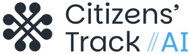
    </a>
    
    <nav style="display: flex; gap: 1.5rem; align-items: center;">
      <a href="#about" style="color: var(--ct-color-ebony-clay); text-decoration: none; font-weight: 500;">About</a>
      <a href="#assemblies" style="color: var(--ct-color-ebony-clay); text-decoration: none; font-weight: 500;">Assemblies</a>
      <a href="#contact" style="background: var(--ct-color-cerulean); color: #fff; padding: 0.5rem 1rem; border-radius: 6px; text-decoration: none; font-weight: 600;">Get Started</a>
    </nav>
  </header>

</body>
</html>
```

---

## 8. Version & Contact Information
- **Brand System Version:** 1.0 (October 2026)
- **Official Portal:** [citizens-track.org](https://citizens-track.org)
- **Branding Agency:** Convincible Media
- **Organization:** Connected By Data

*For any questions regarding licensing, emblem usage exceptions, or print separations, contact the Citizens' Track on AI communications team at contact@citizens-track.org.*
